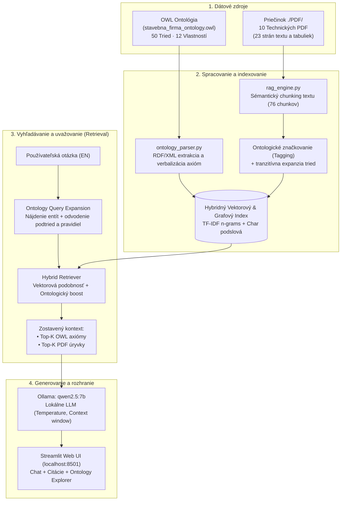

# 🏗️ ApexBuild — Hybrid Ontology-Enhanced RAG System

[](https://www.python.org/)
[](https://streamlit.io/)
[](https://ollama.ai/)
[](https://www.w3.org/OWL/)
[]()

> Pokročilý **Ontology-Enhanced RAG (Retrieval-Augmented Generation)** systém v anglickom jazyku, ktorý spája formálny sémantický web (OWL ontológiu stavebnej firmy s 50 triedami a 12 vlastnosťami) s kolekciou **10 doménových technických PDF dokumentov** a lokálnym jazykovým modelom **Qwen 2.5 (7B)** bežiacim cez **Ollama**.

---

## 📖 Obsah

- [Prehľad projektu](#-prehľad-projektu)
- [Prečo Hybrid Ontology-RAG?](#-prečo-hybrid-ontology-rag)
- [Architektúra systému](#-architektúra-systému)
- [Ako to celé funguje (Pipeline krok za krokom)](#-ako-to-celé-funguje-pipeline-krok-za-krokom)
- [Prehľad 10 PDF dokumentov v `./PDF/`](#-prehľad-10-pdf-dokumentov-v-pdf)
- [Použité technológie a modely](#-použité-technológie-a-modely)
- [Štruktúra repozitára](#-štruktúra-repozitára)
- [Inštalácia a spustenie](#-inštalácia-a-spustenie)
- [Používateľské rozhranie (Web UI)](#-používateľské-rozhranie-web-ui)
- [Ukážkové dopyty a ontologické uvažovanie](#-ukážkové-dopyty-a-ontologické-uvažovanie)

---

## 💡 Prehľad projektu

Tradičné RAG systémy indexujú iba voľný text (neštruktúrované PDF dokumenty). Keď používateľ položí otázku týkajúcu sa logických vzťahov, dedičnosti, obmedzení alebo pravidiel (napr. *„Prečo drevodom nemôže použiť betón?“* alebo *„Aký je formálny rozdiel medzi elektrikárom a inštalatérom?“*), klasický vektorový RAG často zlyháva alebo halucinuje, pretože mu chýba formálna schéma vzťahov.

Tento projekt implementuje **Hybrid Ontology-RAG**, ktorý prepája:
1. **Formálnu OWL ontológiu stavebnej firmy** (`stavebna_firma_ontology - kópia.owl`) – 50 tried, 12 vlastností, dedičnosť (`rdfs:subClassOf`), obmedzenia (`owl:Restriction`), disjunktnosť (`owl:disjointWith`) a ekvivalentné triedy (`owl:equivalentClass`).
2. **Kolekciu 10 odborných PDF dokumentov** (`./PDF/`) – 23 strán detailných technických správ, rozpočtov, personálnych matíc, strojového parku a noriem EN/Eurocode.
3. **Lokálny LLM model Qwen 2.5 (7B)** – zabezpečuje 100 % privátne, bezplatné generovanie odpovedí s citáciou presných zdrojov (strán PDF a axióm z ontológie).

---

## 🧠 Prečo Hybrid Ontology-RAG?

```
┌────────────────────────────────────────┐      ┌────────────────────────────────────────┐
│          Klasický Vektorový RAG        │      │       Náš Hybrid Ontology-RAG          │
├────────────────────────────────────────┤      ├────────────────────────────────────────┤
│ • Vyhľadáva iba textovú podobnosť      │      │ • Spája textovú a grafovú sémantiku    │
│ • Nerozumie logickým zákazom (Disjoint)│      │ • Pozná disjunktnosť (Wood vs Concrete)│
│ • Nerozumie hierarchii podtried        │      │ • Automaticky expanduje nadtriedy      │
│ • Ignoruje formálne obmedzenia (Axioms)│      │ • Verbalizuje OWL axiómy priamo pre LLM│
│ • Vysoké riziko halucinácií            │      │ • Prísne uzemnené (grounded) odpovede  │
└────────────────────────────────────────┘      └────────────────────────────────────────┘
```

---

## 🏛️ Architektúra systému



---

## ⚙️ Ako to celé funguje (Pipeline krok za krokom)

### 1. Parsovanie a verbalizácia ontológie (`ontology_parser.py`)
- Načíta súbor `stavebna_firma_ontology - kópia.owl` cez priamy XML strom bez nutnosti ťažkých externých knižníc.
- Extrahuje:
  - **Hierarchiu tried:** `EuroveaTower` $\sqsubseteq$ `ApartmentBuilding` $\sqsubseteq$ `ResidentialProject` $\sqsubseteq$ `BuildingProject` $\sqsubseteq$ `Project`.
  - **Existenčné a univerzálne obmedzenia:** `usesMaterial some Concrete`, `usesMaterial only Wood`.
  - **Ekvivalentné triedy:** `ManagementRole ≡ SiteManager ⊔ Architect`, `ManualWorker ≡ Electrician ⊔ Plumber`.
  - **Disjunktnosť:** `Concrete` je disjunktný s `Wood` a `Glass`.
  - **Časové intervaly (`year`):** `HistoricalProject` ($< 1950$), `MidCenturyProject` ($1950 - 2000$), `ModernProject` ($\ge 2000$), `FutureProject` ($\ge 2027$).
- Každú entitu preloží do čitateľného anglického formátu (tzv. *Verbalized Axiom*), ktorý je pripravený na indexovanie a pre LLM prompt.

### 2. Spracovanie a ontologické značkovanie PDF dokumentov (`rag_engine.py`)
- Načíta všetkých 10 PDF dokumentov z priečinka `./PDF/`.
- Rozdelí text na prekrývajúce sa sémantické bloky (**76 chunkov**, veľkosť ~850 znakov, overlap 150 znakov).
- **Ontology Tagging:** Každý chunk textu je automaticky preskenovaný na prítomnosť tried a ich synoným. Ak chunk spomína napr. bager a betón, obohatí sa o tagy `Excavator`, `ConstructionMachine`, `Concrete`, `Material`.

### 3. Hybridné vyhľadávanie s grafovou expanziou
- Keď používateľ zadá otázku (napr. *"Which workers are assigned to residential projects?"*):
  1. **Detekcia entít:** Systém identifikuje kľúčové pojmy (`ResidentialProject`, `Employee`, `Worker`).
  2. **Grafová expanzia:** Z ontológie načíta tranzitívne podtriedy (`Plumber`, `Designer`, `FamilyHouse`, `ApartmentBuilding`) a pravidlá priradenia (`worksOn`, `hasProject`).
  3. **Hybridné skórovanie:** Kombinuje kosínusovú podobnosť slovných $1-2$ gramov a podznakových $3-5$ gramov so sémantickým boostom za zhodu s grafom ontológie.
  4. **Výber Top-K:** Vráti napr. 5 najrelevantnejších úryvkov z PDF a 6 formálnych axióm z ontológie.

### 4. Generovanie odpovede cez Ollama (`qwen2.5:7b`)
- Zostaví systémový prompt, v ktorom LLM dostane prísnu inštrukciu odpovedať výhradne na základe doručených axióm a PDF úryvkov.
- LLM streamuje odpoveď v reálnom čase priamo do prehliadača.
- Pod každou odpoveďou vygeneruje rozbaľovaciu sekciu **📚 View Sources & Ontology Context**, kde presne ukáže, ktoré strany PDF a aké axiómy z ontológie boli použité.

---

## 📑 Prehľad 10 PDF dokumentov v `./PDF/`

Všetkých 10 dokumentov bolo generovaných skriptom `generate_pdfs.py` a tvoria ucelenú dokumentáciu firmy **ApexBuild Construction Corp.**:

| Súbor | Rozsah | Kľúčové témy | Pokryté triedy z ontológie |
|---|---|---|---|
| `01_company_profile_and_organization.pdf` | 3 strany | Profil firmy, organizačné divízie, obraty, register klientov (CUST-101 až 105) a časové obdobia. | `ConstructionCompany`, `Customer`, `Employee`, `ManagementRole`, `ProjectPeriod`, `hasCustomer`, `hasEmployee`, `hasProject` |
| `02_employee_roles_and_safety_manual.pdf` | 3 strany | Kompetenčná matica zamestnancov, rozdiel `Electrician` vs. `Plumber`, BOZP (HSE) smernice. | `SiteManager`, `Architect`, `Designer`, `ConstructionWorker`, `ManualWorker`, `Electrician`, `Plumber`, `worksOn` |
| `03_residential_projects_catalog.pdf` | 2 strany | Rezidenčné stavby, špecifikácia referenčnej vily `FamilyHouseExample` (2026) a drevodomov `WoodenHouse`. | `ResidentialProject`, `FamilyHouse`, `FamilyHouseExample`, `WoodenHouse`, `ModernProject`, `year` |
| `04_eurovea_tower_and_apartments.pdf` | 2 strany | Prípadová štúdia mrakodrapu `EuroveaTower` (2023, 168 m, 46 poschodí), betón C60/75, žeriavy a rozpočet €115M. | `ApartmentBuilding`, `EuroveaTower`, `FamousProject`, `Concrete`, `Crane`, `usesMaterial`, `usesMachine` |
| `05_commercial_and_office_buildings.pdf` | 2 strany | Komerčné a administratívne budovy, úloha architektov, porovnanie `EmpireStateBuilding` (1931) a moderných stavieb. | `CommercialProject`, `OfficeBuilding`, `EmpireStateBuilding`, `HistoricalProject`, `Architect`, `Steel` |
| `06_industrial_and_reconstruction_projects.pdf` | 2 strany | Priemyselné haly, rekonštrukcie stavieb 20. storočia (`MidCenturyProject`) a plánované projekty po roku 2027 (`FutureProject`). | `IndustrialProject`, `Reconstruction`, `MidCenturyProject`, `FutureProject`, `BuildingProject` |
| `07_construction_materials_specification.pdf` | 2 strany | Normy 6 podtried materiálov, pevnosti, laboratórne skúšky a pravidlá disjunktnosti (`Concrete` vs. `Wood`/`Glass`). | `Material`, `Concrete`, `Brick`, `Steel`, `Wood`, `Insulation`, `Glass`, `usesMaterial`, `owl:disjointWith` |
| `08_suppliers_and_procurement_policy.pdf` | 2 strany | Register 6 schválených dodávateľov (SUP-01 až 06), 60-minútové SLA okno na čerstvý betón a zmluvné pokuty. | `Supplier`, `Material`, `Concrete`, `suppliesMaterial` |
| `09_heavy_machinery_fleet_and_operations.pdf` | 2 strany | Strojový park (bágre, žeriavy, nakladače, autá), inverzné vlastnosti `usesMachine` $\leftrightarrow$ `belongsToProject`, veterné limity. | `ConstructionMachine`, `Excavator`, `Crane`, `Loader`, `Truck`, `usesMachine`, `belongsToProject` |
| `10_construction_phases_and_workflows.pdf` | 3 strany | 4 fázy výstavby (`Planning`, `Foundation`, `StructuralWork`, `FinishingWork`), kontrolné brány kvality QG-1 až QG-4. | `ConstructionPhase`, `Planning`, `Foundation`, `StructuralWork`, `FinishingWork` |

---

## 🛠️ Použité technológie a modely

- **LLM:** [Qwen 2.5 (7B Instruct)](https://ollama.com/library/qwen2.5:7b) bežiaci lokálne cez **Ollama** (`http://localhost:11434`).
- **Web UI:** **Streamlit** (responzívny chat, podpora Dark/Light módu, interaktívne filtre).
- **PDF Engine:** **PyMuPDF (`fitz`)** s modulom `Story` pre precízne generovanie a extrakciu štruktúrovaného textu.
- **Ontology Parser:** Vlastný rýchly XML parser pre štandardy **OWL 2 DL** a **RDF/XML** (`xml.etree.ElementTree`).
- **Retrieval & NLP:** **Scikit-Learn** (sublineárne TF-IDF matice, kosínusová podobnosť, char-wb podslová) kombinované s grafovým uvažovaním.

---

## 📁 Štruktúra repozitára

```text
├── PDF/                                         # 10 vygenerovaných PDF dokumentov (23 strán v EN)
│   ├── 01_company_profile_and_organization.pdf
│   ├── 02_employee_roles_and_safety_manual.pdf
│   ├── 03_residential_projects_catalog.pdf
│   ├── 04_eurovea_tower_and_apartments.pdf
│   ├── 05_commercial_and_office_buildings.pdf
│   ├── 06_industrial_and_reconstruction_projects.pdf
│   ├── 07_construction_materials_specification.pdf
│   ├── 08_suppliers_and_procurement_policy.pdf
│   ├── 09_heavy_machinery_fleet_and_operations.pdf
│   └── 10_construction_phases_and_workflows.pdf
├── stavebna_firma_ontology - kópia.owl          # Zdrojová OWL ontológia (50 tried, 12 properties)
├── app.py                                       # Hlavné Streamlit používateľské rozhranie (localhost:8501)
├── rag_engine.py                                # Hybridný RAG engine a klient pre Ollama API
├── ontology_parser.py                           # Parser a verbalizér OWL ontológie
├── generate_pdfs.py                             # Generátor 10 viacstranových PDF dokumentov
├── requirements.txt                             # Zoznam závislostí pre Python
├── start.md                                     # Stručný návod na spustenie a vypnutie
├── zadanie3.md                                  # Pôvodné zadanie a technická dokumentácia
└── README.md                                    # Tento prehľadový dokument pre GitHub
```

---

## 🚀 Inštalácia a spustenie

### 1. Klonovanie repozitára a inštalácia knižníc
```bash
git clone https://github.com/your-username/construction-ontology-rag.git
cd construction-ontology-rag

pip install -r requirements.txt
```

### 2. Spustenie a stiahnutie modelu v Ollame
Nainštalujte [Ollamu](https://ollama.ai/) a stiahnite odporúčaný model:
```bash
ollama pull qwen2.5:7b
```

### 3. Spustenie webovej aplikácie
```bash
streamlit run app.py
```
Aplikácia sa automaticky otvorí v prehliadači na adrese:
👉 **`http://localhost:8501`**

---

## 🖥️ Používateľské rozhranie (Web UI)

Aplikácia je rozdelená do troch prehľadných modulov:

1. **💬 AI Chat Assistant:**
   - Čisté chatové okno v štýle moderných AI asistentov.
   - 6 interaktívnych navrhovaných otázok na jedno kliknutie.
   - Možnosť nastavenia parametrov generovania v reálnom čase (Temperature, Context Size, Top-K, vypnutie/zapnutie grafovej expanzie).
   - Rozbaľovacia sekcia **📚 View Sources & Ontology Context** pod každou odpoveďou (záložky pre PDF citácie, OWL axiómy a strom uvažovania).
2. **📄 PDF Documents Library:**
   - Prehľad všetkých 10 PDF dokumentov, počet strán, veľkosť a zoznam priradených OWL tried.
   - Možnosť prehliadať jednotlivé zaindexované textové chunky.
3. **🧬 OWL Ontology Explorer:**
   - Prehliadač všetkých 50 tried a 12 vlastností z ontológie s fulltextovým filtrom.
   - Zobrazuje tranzitívne nadtriedy, podtriedy a presné znenie logických obmedzení.

---

## 🧪 Ukážkové dopyty a ontologické uvažovanie

| Otázka pre systém (EN) | Čo systém overuje a ako uvažuje |
|---|---|
| **"What is the difference between Electrician and Plumber?"** | V ontológii overí, že `Electrician` má obmedzenie `worksOn some BuildingProject`, zatiaľ čo `Plumber` má prísnejšie obmedzenie `worksOn some ResidentialProject`. Z PDF dokumentu `02` vytiahne konkrétne mená zamestnancov (Jozef Marek vs. Milan Krátky) a ich certifikáty. |
| **"Why can't a WoodenHouse use Concrete?"** | Identifikuje definíciu triedy `WoodenHouse` (`usesMaterial only Wood`) a nájde disjunktnostné pravidlo `Concrete owl:disjointWith Wood`. Z PDF dokumentu `03` vysvetlí konštrukčný systém Tatry CLT. |
| **"Tell me everything about EuroveaTower."** | Prepojí triedy `FamousProject` a `ApartmentBuilding`, zistí rok `2023` (odvodí `ModernProject`), nájde obmedzenie `usesMaterial some Concrete` a z PDF `04` vytiahne výšku 168 m, 46 poschodí, rozpočet €115M a žeriavy Liebherr 280 EC-H. |
| **"Compare EmpireStateBuilding and EuroveaTower."** | Porovná časové obdobia: `EmpireStateBuilding` (1931 $\rightarrow$ `HistoricalProject`) vs. `EuroveaTower` (2023 $\rightarrow$ `ModernProject`), použité materiály (`Steel` vs. `Concrete`) a typy stavieb (`OfficeBuilding` vs. `ApartmentBuilding`). |

---

## 📜 Licencia

Tento projekt vznikol v rámci akademického zadania pre predmet Softvérové a sémantické weby (SaSW). Kód a dokumentácia sú voľne dostupné pre študijné a výskumné účely.

