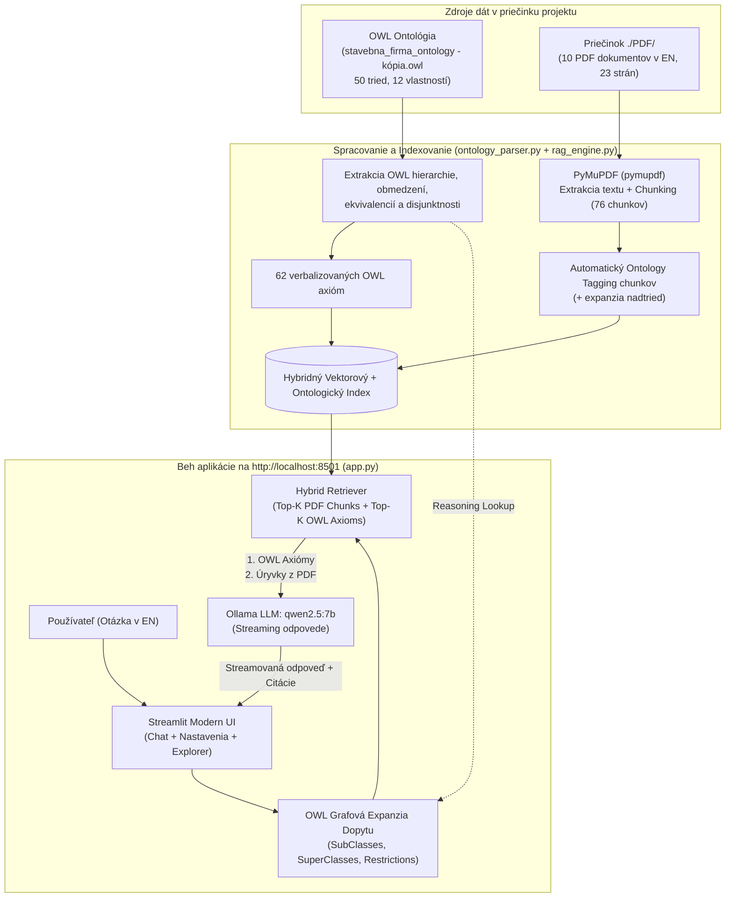

# Zadanie 3: Návrh a implementácia RAG systému pre ontológiu stavebnej firmy

Tento dokument popisuje architektúru a kompletnú implementáciu **Ontology-Enhanced RAG (Retrieval-Augmented Generation)** systému v **anglickom jazyku**, postaveného nad OWL ontológiou stavebnej firmy (`stavebna_firma_ontology - kópia.owl`) a kolekciou **10 viacstranových doménových PDF dokumentov** v priečinku `./PDF/`, s lokálnym LLM modelom **`qwen2.5:7b`** (cez Ollama) a moderným webovým rozhraním (Streamlit UI) bežiacim na `http://localhost:8501`.

---

## 1. Prečo je RAG v anglickom jazyku?

Voľba anglického jazyka pre PDF dokumenty, dopyty aj odpovede prináša v tomto projekte tri zásadné výhody:
1. **100 % zhoda s identifikátormi v OWL ontológii:** Súbor `stavebna_firma_ontology - kópia.owl` definuje všetkých **50 tried** (`ConstructionCompany`, `SiteManager`, `ResidentialProject`, `EuroveaTower`, `EmpireStateBuilding`, `Excavator`, `Concrete` atď.) a **12 vlastností** (`usesMaterial`, `usesMachine`, `worksOn`, `suppliesMaterial`, `hasSiteManager`, `belongsToProject`, `year` atď.) v angličtine. Odpadá tak chybovosť pri preklade medzi slovenčinou a URI identifikátormi v ontológii.
2. **Presnejšie sémantické a lexikálne vyhľadávanie:** Priame prepojenie anglických odborných pojmov v PDF s názvami OWL tried umožňuje automatické ontologické značkovanie (tagging) každého úryvku textu.
3. **Vysoká kvalita logického uvažovania (Reasoning) modelu `qwen2.5:7b`:** Model Qwen 2.5 (7B Instruct) dosahuje v angličtine vynikajúcu presnosť pri spájaní formálnych OWL pravidiel (dedičnosť, disjunktnosť, existenčné a univerzálne obmedzenia) s faktickými údajmi z PDF tabuliek.

---

## 2. Kolekcia 10 PDF dokumentov v priečinku `./PDF/`

Pomocou generátora `generate_pdfs.py` bolo v priečinku `./PDF/` vytvorených **10 plnohodnotných, viacstranových PDF dokumentov v angličtine** (spolu **23 strán / 76 sémantických chunkov**), ktoré tvoria ucelenú technickú a prevádzkovú dokumentáciu fiktívnej stavebnej spoločnosti **ApexBuild Construction Corp.** a pokrývajú každú triedu a obmedzenie z OWL ontológie:

| # | Názov súboru v `./PDF/` | Rozsah | Téma dokumentu (EN) | Prepojené triedy a vlastnosti z OWL ontológie |
|---|---|---|---|---|
| **1** | `01_company_profile_and_organization.pdf` | 3 strany | Profil firmy ApexBuild Construction Corp., divízie, obraty, register klientov (CUST-101 až CUST-105) a časové obdobia projektov. | `ConstructionCompany`, `Customer`, `Employee`, `ManagementRole`, `ProjectPeriod`, `hasCustomer`, `hasEmployee`, `hasProject` |
| **2** | `02_employee_roles_and_safety_manual.pdf` | 3 strany | Kompetenčná matica zamestnancov, rozdiel medzi `Electrician` a `Plumber`, certifikáty a smernica BOZP (HSE). | `SiteManager`, `Architect`, `Designer`, `ConstructionWorker`, `ManualWorker`, `Electrician`, `Plumber`, `worksOn` |
| **3** | `03_residential_projects_catalog.pdf` | 2 strany | Katalóg rezidenčných stavieb, špecifikácia vily `FamilyHouseExample` (2026) a CLT drevodomov `WoodenHouse`. | `ResidentialProject`, `FamilyHouse`, `FamilyHouseExample`, `WoodenHouse`, `ModernProject`, `year` |
| **4** | `04_eurovea_tower_and_apartments.pdf` | 2 strany | Prípadová štúdia mrakodrapu `EuroveaTower` (2023, 168 m, 46 podlaží), monolitický betón C60/75 a nasadenie žeriavov. | `ApartmentBuilding`, `EuroveaTower`, `FamousProject`, `Concrete`, `Crane`, `usesMaterial`, `usesMachine` |
| **5** | `05_commercial_and_office_buildings.pdf` | 2 strany | Komerčné a administratívne budovy, úloha architektov a porovnanie `EmpireStateBuilding` (1931) s `EuroveaTower` (2023). | `CommercialProject`, `OfficeBuilding`, `EmpireStateBuilding`, `HistoricalProject`, `Architect`, `Steel` |
| **6** | `06_industrial_and_reconstruction_projects.pdf` | 2 strany | Priemyselné haly (Trnava Smart Hall), rekonštrukcie stavieb z 20. storočia a pripravované projekty po roku 2027. | `IndustrialProject`, `Reconstruction`, `MidCenturyProject`, `FutureProject`, `BuildingProject` |
| **7** | `07_construction_materials_specification.pdf` | 2 strany | Technické normy 6 podtried materiálov, pevnostné triedy, laboratórne skúšky a pravidlá disjunktnosti (`Concrete` vs. `Wood`/`Glass`). | `Material`, `Concrete`, `Brick`, `Steel`, `Wood`, `Insulation`, `Glass`, `usesMaterial`, `owl:disjointWith` |
| **8** | `08_suppliers_and_procurement_policy.pdf` | 2 strany | Register 6 certifikovaných dodávateľov (SUP-01 až SUP-06), SLA limity pre čerstvý betón a odberateľské zmluvy. | `Supplier`, `Material`, `Concrete`, `suppliesMaterial` |
| **9** | `09_heavy_machinery_fleet_and_operations.pdf` | 2 strany | Katalóg stavebnej techniky (EXC-01 až TRK-01), inverzné vlastnosti `usesMachine` / `belongsToProject` a veterné limity žeriavov. | `ConstructionMachine`, `Excavator`, `Crane`, `Loader`, `Truck`, `usesMachine`, `belongsToProject` |
| **10** | `10_construction_phases_and_workflows.pdf` | 3 strany | Štyri etapy výstavby, priradenie profesií, strojov, materiálov a kontrolné brány kvality (Quality Gates QG-1 až QG-4). | `ConstructionPhase`, `Planning`, `Foundation`, `StructuralWork`, `FinishingWork` |

---

## 3. Použitý model a technologický stack

* **Lokálny LLM model (cez Ollama):** **`qwen2.5:7b`** (`Q4_K_M`, 7.6B parametrov, kontextové okno až 32 768 tokenov), bežiaci lokálne cez REST API na `http://localhost:11434`.
  * *Prečo `qwen2.5:7b`:* Vyniká v presnom dodržiavaní kontextu (grounded RAG), rozumie formálnym ontologickým zápisom (`rdfs:subClassOf`, `owl:Restriction`, `owl:disjointWith`, `owl:equivalentClass`) a poskytuje rýchle streamovanie odpovedí na lokálnom hardvéri.
* **Spracovanie OWL ontológie (`ontology_parser.py`):** Priamy RDF/XML parser a verbalizér, ktorý zo súboru `stavebna_firma_ontology - kópia.owl` extrahuje 50 tried a 12 vlastností a prevádza ich na **62 štruktúrovaných ontologických pravidiel** vrátane tranzitívnej dedičnosti nadtried a podtried.
* **Hybridné vyhľadávanie (`rag_engine.py`):** Kombinuje viacúrovňovú kosínusovú podobnosť (slovné 1–2 gramy + znakové podslová 3–5 gramov cez `scikit-learn`) s **OWL grafovou expanziou dopytu** (rozšírenie otázky o podtriedy, nadtriedy, ekvivalentné triedy a obmedzenia z ontológie).
* **Webové používateľské rozhranie (`app.py`):** **Streamlit** aplikácia bežiaca na `http://localhost:8501`.

---

## 4. Architektúra systému: Hybrid Ontology-RAG



---

## 5. Funkcie webového rozhrania (`http://localhost:8501`)

Webové UI v súbore `app.py` ponúka:
1. **Ľavý panel nastavení (Sidebar):**
   * Výber modelu zo živého Ollama servera (predvolene **`qwen2.5:7b`**).
   * **Temperature** (`0.0 – 1.5`, predvolene `0.2` pre prísne faktické odpovede).
   * **Context Window Size (`num_ctx`)** (`2048` až `32768` tokenov, predvolene `8192`).
   * **Max Tokens (`num_predict`)** a **Top-P (`top_p`)**.
   * **Hybrid Retrieval nastavenia:** prepínač *Enable OWL Ontology Graph Expansion*, posuvníky pre *Top-K PDF Chunks* (`1 – 10`, predvolene `5`) a *Top-K OWL Axioms* (`1 – 10`, predvolene `6`).
   * Nastavenie veľkosti chunkov (`Chunk Size`, `Chunk Overlap`), úprava **System Promptu** a tlačidlá **🔄 Re-index Data** a **🗑️ Clear Chat**.
2. **Tri hlavné karty (Tabs):**
   * **💬 Chat Assistant (EN):** Interaktívny chat s 5 rýchlymi ukážkovými otázkami na jedno kliknutie. Pod každou odpoveďou sa nachádza rozbaľovací box **🔍 Retrieved Knowledge Context**, ktorý zobrazuje nájdené OWL entity, aktívne odvodenia z ontológie, presné úryvky z PDF (vrátane strany a skóre) a použité OWL axiómy.
   * **🧬 OWL Ontology Explorer:** Interaktívny prehliadač všetkých 50 tried a 12 vlastností z `.owl` súboru s okamžitým filtrovaním.
   * **📄 PDF Documents Library:** Prehľadová tabuľka všetkých 10 PDF dokumentov a čítačka jednotlivých zaindexovaných chunkov s ich ontologickými značkami.

---

## 6. Štruktúra súborov projektu a návod na spustenie

```text
RAG/
├── PDF/                                         # 10 vygenerovaných viacstranových PDF dokumentov (v EN)
│   ├── 01_company_profile_and_organization.pdf
│   ├── 02_employee_roles_and_safety_manual.pdf
│   ├── 03_residential_projects_catalog.pdf
│   ├── 04_eurovea_tower_and_apartments.pdf
│   ├── 05_commercial_and_office_buildings.pdf
│   ├── 06_industrial_and_reconstruction_projects.pdf
│   ├── 07_construction_materials_specification.pdf
│   ├── 08_suppliers_and_procurement_policy.pdf
│   ├── 09_heavy_machinery_fleet_and_operations.pdf
│   └── 10_construction_phases_and_workflows.pdf
├── stavebna_firma_ontology - kópia.owl          # Zdrojová OWL ontológia stavebnej firmy
├── generate_pdfs.py                             # Skript na generovanie 10 PDF dokumentov (PyMuPDF Story)
├── ontology_parser.py                           # RDF/XML parser a verbalizér OWL ontológie
├── rag_engine.py                                # Hybridný RAG engine + komunikácia s Ollama API
├── app.py                                       # Streamlit Web UI aplikácia (localhost:8501)
├── requirements.txt                             # Zoznam závislostí
└── zadanie3.md                                  # Dokumentácia návrhu a implementácie
```

### Postup spustenia:
```bash
# 1. Uistite sa, že beží Ollama a máte stiahnutý model qwen2.5:7b
ollama pull qwen2.5:7b

# 2. (Voliteľné) Prekreslenie / opätovné vygenerovanie 10 PDF dokumentov v ./PDF/
python3 generate_pdfs.py

# 3. Spustenie webového rozhrania na http://localhost:8501
streamlit run app.py
```
